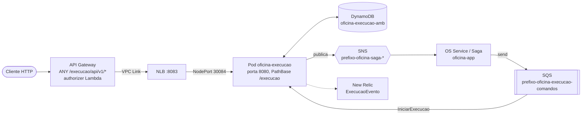
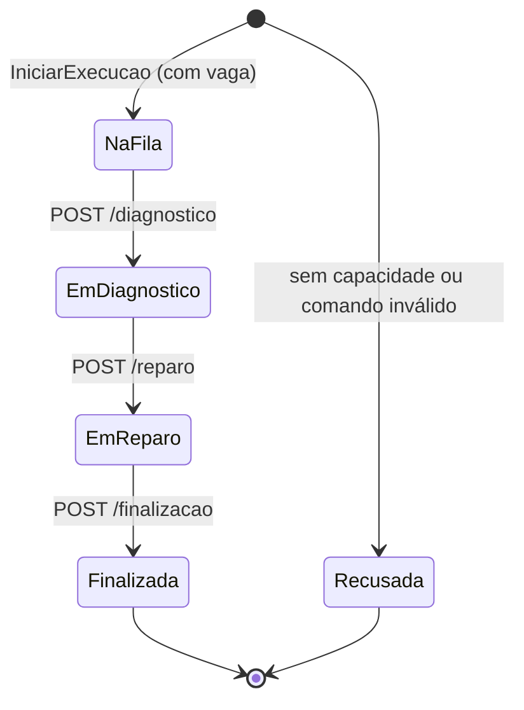

# Oficina Execução Service

[](https://github.com/lcr-thiago-fernandes/oficina-execucao-service/actions/workflows/ci.yml)

Microsserviço de **execução** da oficina (FIAP 15SOAT, Fase 4): recebe a OS paga, coloca na fila de
execução por unidade e acompanha diagnóstico, reparo e finalização. .NET 8, DynamoDB, SQS/SNS (MassTransit),
JWT, New Relic.

## Papel na Saga

Participante da saga **orquestrada** da OS (o orquestrador fica no OS Service, `oficina-app`). **A entrada na fila é o passo pivô**
(spec §4.2): depois de `ExecucaoEnfileirada` não se desfaz a gravação; se não há capacidade (ou o comando é
inválido) o serviço publica `ExecucaoRecusada` e o orquestrador compensa (estorno no Billing/Mercado Pago, estoque restaurado e OS → Cancelada).
Design completo: [fase4-design-arquitetural.md](https://github.com/lcr-thiago-fernandes/oficina-app/blob/develop/docs/arquitetura/fase4-design-arquitetural.md).

## Arquitetura



Camadas (`src/`): `Dominio` → `Aplicacao` → `Infraestrutura` → `Api`. Detalhes e decisões em
[`docs/arquitetura/`](docs/arquitetura/README.md): [ADR-001](docs/arquitetura/ADR-001-dynamodb-contador-por-unidade.md)
(DynamoDB e contador por unidade) e [ADR-002](docs/arquitetura/ADR-002-idempotencia-sem-outbox.md)
(idempotência, sem outbox).

### Máquina de estados



Transição fora de ordem responde `422`. `Finalizada` libera a vaga da unidade.

## API

Todos os endpoints exigem JWT (HS256, `iss=oficina-auth`, `aud=oficina-api`) com `perfil` Atendente ou Admin,
exceto `/health` e `/swagger`. Via API Gateway: prefixo `/execucao/api/v1/...`.

| Método | Rota | Descrição | Resposta |
|---|---|---|---|
| GET | `/execucao/api/v1/execucoes[?status=NaFila]` | Lista execuções (ativas, ou por status) | 200 |
| GET | `/execucao/api/v1/execucoes/{osId}` | Consulta uma execução | 200, 404 |
| POST | `/execucao/api/v1/execucoes/{osId}/diagnostico` | NaFila → EmDiagnostico | 200, 404, 422 |
| POST | `/execucao/api/v1/execucoes/{osId}/reparo` | EmDiagnostico → EmReparo | 200, 404, 422 |
| POST | `/execucao/api/v1/execucoes/{osId}/finalizacao` | EmReparo → Finalizada | 200, 404, 422 |
| GET | `/execucao/health` | Saúde (anônimo) | 200 |
| GET | `/execucao/swagger` | Swagger UI (anônimo); JSON em `/execucao/swagger/v1/swagger.json` | 200 |

Sem token: `401`; perfil Cliente: `403`. Roteiro de chamadas: [`http/execucao.http`](http/execucao.http).

## Mensagens

Contratos (JSON e regras) em [`docs/contratos/mensagens/`](docs/contratos/mensagens/README.md); verificados por testes de contrato.

| Direção | Mensagem | Destino / origem |
|---|---|---|
| Consome | `IniciarExecucao` | fila `{prefixo}-oficina-execucao-comandos` |
| Publica | `ExecucaoEnfileirada` (com `PosicaoFila`) | tópico `{prefixo}-oficina-saga-ExecucaoEnfileirada` |
| Publica | `ExecucaoRecusada` (com motivo) | tópico `{prefixo}-oficina-saga-ExecucaoRecusada` |
| Publica | `StatusExecucaoAlterado` | tópico `{prefixo}-oficina-saga-StatusExecucaoAlterado` |
| Publica | `ExecucaoFinalizada` | tópico `{prefixo}-oficina-saga-ExecucaoFinalizada` |

`{prefixo}` ∈ `local | hml | prd`. Pontos de contrato entre repositórios: [`docs/contratos.md`](docs/contratos.md).

## Configuração

Variáveis de ambiente no padrão `Secao__Chave` (ou `appsettings.json`).

| Chave | Padrão | Descrição |
|---|---|---|
| `Jwt__Secret` | (vazio, obrigatório) | Segredo HS256 (>= 32 chars), o mesmo de `oficina/jwt_secret` |
| `Jwt__Issuer` | `oficina-auth` | Emissor esperado |
| `Jwt__Audience` | `oficina-api` | Audiência esperada |
| `Execucao__CapacidadeMaximaPorUnidade` | `20` | Execuções ativas por unidade; `0` força recusa (demo) |
| `Mensageria__Transporte` | `AmazonSqs` | `AmazonSqs` ou `InMemory` |
| `Mensageria__PrefixoAmbiente` | `local` | Prefixo de filas/tópicos (`[a-z0-9-]+`) |
| `Mensageria__Regiao` | `us-east-1` | Região SQS/SNS |
| `Mensageria__ServiceUrl` | (vazio) | Endpoint alternativo (LocalStack) |
| `DynamoDb__NomeTabela` | `oficina-execucao-local` | Tabela |
| `DynamoDb__Regiao` | `us-east-1` | Região |
| `DynamoDb__ServiceUrl` | (vazio) | Endpoint alternativo (DynamoDB Local) |
| `DynamoDb__CriarTabelaSeAusente` | `false` | Só para dev local; em hml/prd o Terraform cria |
| `NEW_RELIC_APP_NAME` | `oficina-execucao` | Nome no New Relic |

Este serviço não tem segredo próprio: usa `oficina/jwt_secret` e a licença do New Relic, compartilhados. Na AWS
as credenciais vêm do IRSA.

## Como rodar

```bash
cp .env.example .env            # defina JWT_SECRET
docker compose --env-file .env -f docker/docker-compose.yml up -d --build --wait
./scripts/gerar-token-dev.sh Atendente           # imprime um JWT de desenvolvimento
./scripts/enviar-iniciar-execucao.sh             # envia IniciarExecucao para a fila local
```

API em `http://localhost:8083/execucao` (Swagger em `/execucao/swagger`); roteiro de chamadas em
[`http/execucao.http`](http/execucao.http).

**Demo de compensação (capacidade 0):** suba com `CAPACIDADE=0` (variável lida pelo compose), envie
`IniciarExecucao` e observe `ExecucaoRecusada` (motivo de capacidade esgotada). No cluster:
`kubectl -n oficina-prd set env deployment/oficina-execucao Execucao__CapacidadeMaximaPorUnidade=0`.

## Testes

```bash
dotnet test OficinaExecucao.sln
```

**Docker é obrigatório** (Testcontainers com DynamoDB Local 2.5.2 e LocalStack 3.8.1). Projetos em `tests/`:
`Dominio.Testes` (unidade), `Aplicacao.Testes` (handlers, contratos de mensagem), `Infraestrutura.Testes`
(integração: DynamoDB e SQS/SNS reais em contêiner), `Api.Testes` (HTTP, JWT, Swagger) e `Bdd.Testes`
(Gherkin em português: fluxo completo e recusa por capacidade).

### Evidência de cobertura

Gate do CI: cobertura de linhas **>= 80%**. Medido localmente com o mesmo comando do `ci.yml`
(165 testes, 0 falhas), consolidado com ReportGenerator 5.5.11:

| Projeto | Linhas | Branches |
|---|---|---|
| `Oficina.Execucao.Dominio` | 100% | 100% |
| `Oficina.Execucao.Aplicacao` | 100% | 97,1% |
| `Oficina.Execucao.Infraestrutura` | 97,1% | 86,8% |
| `Oficina.Execucao.Api` | 90,6% | 70,0% |
| **Total** | **96,6%** (802 de 830 linhas) | **87,5%** (218 de 249) |

Saída completa: [`docs/evidencias/cobertura-Summary.txt`](docs/evidencias/cobertura-Summary.txt). O relatório HTML é
publicado a cada execução do CI como artefato `coverage-report`
([execuções do CI](https://github.com/lcr-thiago-fernandes/oficina-execucao-service/actions/workflows/ci.yml)).

## Por que não há outbox

DynamoDB e SQS/SNS não compartilham transação. Em vez de uma tabela outbox, o serviço **grava antes de publicar**
e o consumidor de `IniciarExecucao` é idempotente: uma reentrega republica o resultado já gravado
(spec §4.2). Racional completo e desvio do retry em [ADR-002](docs/arquitetura/ADR-002-idempotencia-sem-outbox.md).

## CI/CD e qualidade

- CI ([`ci.yml`](.github/workflows/ci.yml)): `build-test` (com gate de 80%), `docker-build`, `codeql`, `format` (advisory) e `sonar`.
- Qualidade de código (job `sonar`), em dois modos:
  - **Sem `SONAR_TOKEN` (situação atual — não há conta SonarCloud):** o job sobe um SonarQube Community **efêmero** como service container (`sonarqube:26.10.0.133078-community`), troca a senha padrão do admin por uma aleatória, gera um token, cria o projeto e roda `dotnet-sonarscanner` com cobertura OpenCover e resultados de teste (trx). Depois consulta o quality gate (o job **falha** se o status for `ERROR`) e publica cobertura, bugs, vulnerabilidades, code smells e duplicação no **resumo da execução do CI** (aba *Summary* do job `sonar` em [Actions](https://github.com/lcr-thiago-fernandes/oficina-execucao-service/actions/workflows/ci.yml)) e no artefato `sonar-summary`. O servidor é descartado ao fim do job: não há dashboard persistente, a evidência é o resumo/artefato de cada execução. O resumo também lista as issues BUG/VULNERABILITY abertas (regra, arquivo:linha, mensagem). Exemplo: [execução 44067637664](https://github.com/lcr-thiago-fernandes/oficina-execucao-service/actions/runs/44067637664) — quality gate `OK`, cobertura 92,2%, 162 testes, 0 bugs, 0 vulnerabilidades, 0 hotspots, 5 code smells, 0% de duplicação, ratings A/A/A, 1.349 linhas de código.
  - **Com `SONAR_TOKEN` (secret) e `SONAR_ORGANIZATION` (variável):** a análise vai para o SonarCloud (`sonar.qualitygate.wait=true`), projeto `<owner>_<repositório>`.
- CD ([`cd.yml`](.github/workflows/cd.yml)): imagem no ECR e deploy em `oficina-hml` (develop) e `oficina-prd` (main). Infra própria em [`terraform/`](terraform) (`infra.yml`).
- Branches `main` e `develop` protegidas (PR, 1 aprovação, checks obrigatórios): [`scripts/setup-branch-protection.sh`](scripts/setup-branch-protection.sh).
